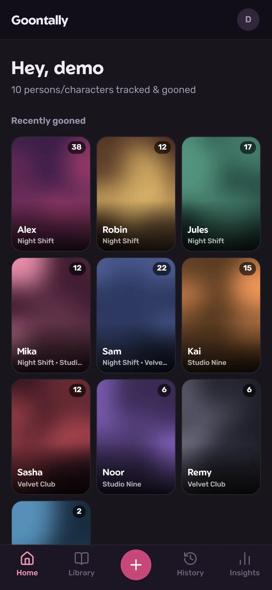
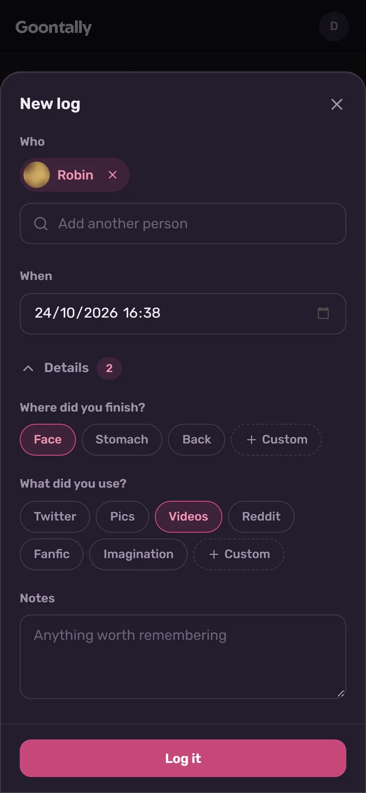
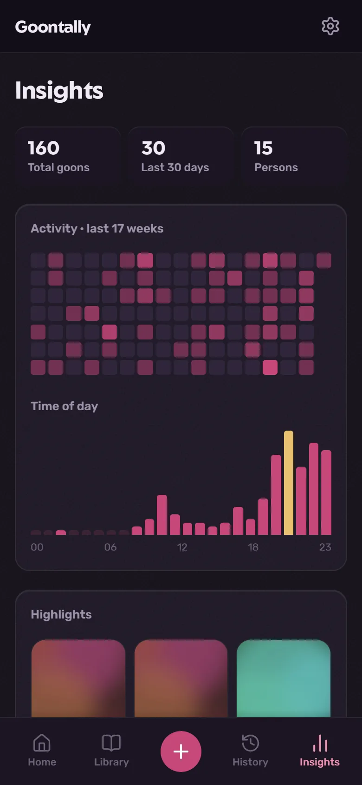
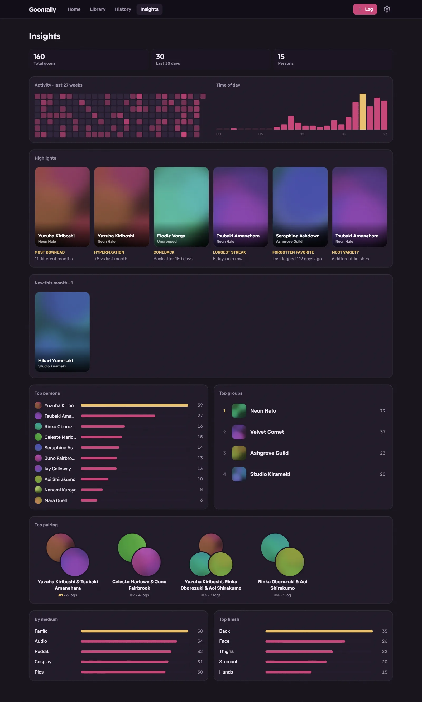
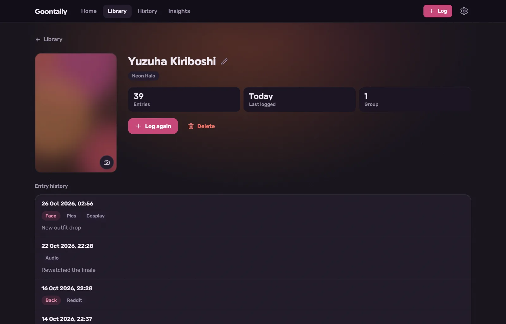
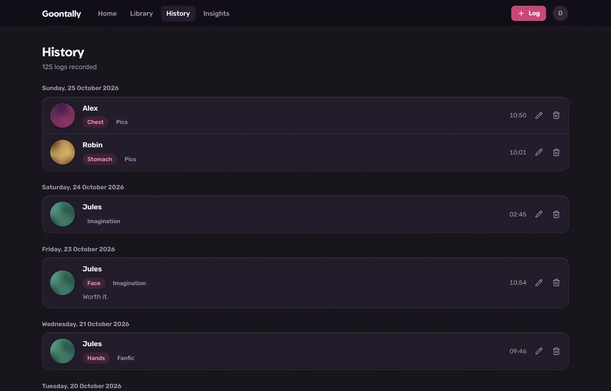

# Goontally

A private tally app for gooning, for Android. Log entries for the persons or
characters in your library, group them, and see your stats & patterns on the
Insights page.

It works for anything or anyone you'd keep a tally of, or whatever it is you goon to. Groups bundle them however you like.

Everything stays on your phone: no account, no server, no internet needed.
It starts as a clean slate and **you add every person and image yourself**.
In return, you can log anything or _anyone_ you want, with stats and
everything, and nobody else sees it.

## Get the app

**[Download the newest APK](https://github.com/bayorumor/goontally/releases/latest)**
from the Releases page.

You need an Android phone with Android 8.0 or newer. iPhone isn't supported.

1. On your phone, open the
   [Releases page](https://github.com/bayorumor/goontally/releases) and
   download the `.apk` file of the newest release.
2. Open the downloaded file. Android asks to allow installing apps from your
   browser (or from Files): allow it for that app.
3. Tap **Install**. If Google Play Protect warns about an unknown app, tap
   **More details → Install anyway**. It says that about any app that isn't
   from the Play Store.
4. Open it from your app drawer. To stay discreet, it's called **GT** there
   and on the home screen.
5. The first time it opens, it shows the terms of use (the same as the
   [Disclaimer](#disclaimer) below); tap **I understand** to start. You can
   reread them any time in **Settings → Terms of Use**.

**Updating:** when a new version is out, a banner in the app says so; tap
**Download**, open the file and install it over the old one. Your data
stays. You can also grab the newest `.apk` from the Releases page yourself.

The app isn't on the Play Store, and won't be: stores don't take apps like
this one.

## Screenshots

Sample data with made-up names and abstract placeholder images.

<p align="center">
  
  
  
</p>

<details>
<summary>Insights, a person's page and History on a wider screen</summary>







</details>

## Features

**Library**

- Add persons with an optional image, cropped to a portrait card.
- Put persons into groups (e.g. fandom name etc.). A person can be
  in several groups, or in none.
- Add existing persons to a group from the group's page ("Add members"),
  or take them out again ("Remove members"; they stay in your library).
- Search by person or group name, and sort by name or by most logged.
- Rename, change images, and delete from each person's or group's page.

**Logging**

- Tap **+** to open the quick-log sheet from anywhere.
- One entry can have several persons. Type a new name to create a person
  on the spot, optionally with a group and an image.
- The time defaults to now and can be changed to log something from earlier.
- Optional details:
  - **Finish** ("Where did you _finish_?"): a short neutral preset list (Face,
    Stomach, Back) plus your own custom ones up to your own fantasy. With
    several persons, each finish says who it was for, or rather "in/on" which
    person.
  - **Medium** ("What did you use?"): Pics, Videos, and so on, plus
    your own custom ones.
  - **Notes**: free text.
- Edit or delete any entry from History.
- Rename or remove finishes and mediums, built-in ones too, in
  **Settings → Log options** or with **Edit** in the log sheet.

**Pages**

- **Home**: everyone you've gooned to, most recent first.
- **History**: every entry grouped by day.
- **Person**: entry count, last logged, groups, and their entry history.
- **Group**: members, entries with any member, and the top member.
- **Insights**:
  - Totals, a GitHub-style activity heatmap, and a time-of-day chart.
  - Top 10 persons and top 5 groups.
  - Top pairings: the persons you most often log together.
  - Top mediums and top finishes.
  - Persons who were new this month.
  - Highlights, each shown only when someone qualifies:

    | Highlight          | Who gets it                                                         |
    | ------------------ | ------------------------------------------------------------------- |
    | Most downbad       | Logged in the most different months                                 |
    | Hyperfixation      | Biggest jump this month compared with last month                    |
    | Comeback           | Logged this month after the longest gap (at least 14 days)          |
    | Longest streak     | Most days in a row with an entry (at least 2)                       |
    | Forgotten favorite | An all-time top 10 person not logged in the longest time (30+ days) |
    | Most variety       | Most different finishes (at least 2)                                |

**Other**

- Works fully offline, in airplane mode too.
- Optional PIN lock (see [Privacy](#privacy)).
- Discreet: it's called **GT** on the home screen, with a plain "GT" icon.
- Backups to one `.gtbak` file, by hand or automatically (see
  [Backups](#backups)).
- Days, months and hours in Insights and History follow your phone's
  timezone.

## Backups

Your data lives only on your phone. **Uninstalling the app deletes it**, and
so does losing the phone, so keep backups. Open **Settings** (the gear at
the top right).

**Export backup** saves everything to one `.gtbak` file and opens Android's
share menu, so you can put it in Google Drive, a folder on the phone (via
Files), a chat with yourself, and so on.

- **Data + images** or **Data only**.
- **Password (optional):** the file is encrypted (AES-256-GCM) and can't be
  opened without it. A forgotten password can't be recovered.

**Automatic backup** makes one daily or weekly, whenever you open the app and
the last one is old enough.

- Saved to **Documents/Goontally** on the phone. That folder stays even if
  the app is uninstalled.
- The newest 5 are kept; older ones are deleted. Files you put there yourself
  are left alone.
- An optional password locks them. It's kept on the phone so backups can run
  on their own.

**Import backup** opens a `.gtbak` file, shows what's inside, then either:

- **Merge:** adds what's missing. Persons and groups with the same name
  (ignoring case) count as the same; entries with the same time and persons
  are skipped. Existing images are never replaced.
- **Replace everything:** deletes everything in the app first, then imports
  the backup.

If the app closes partway through an import, the data itself is saved all at
once or not at all; only images can be missing. Import the same file again
with **Merge** to fill them in.

**New phone, or reinstalled the app?** Install Goontally, open **Settings →
Import backup**, and pick your file. Automatic backups are in
**☰ → (your phone) → Documents → Goontally** in the file picker.

Backups also open in the [web version](#web-version), and the other way
round.

## Privacy

- **Everything stays on the phone.** There's no account and no server; the
  app works without internet.
- **One network request:** once a day the app asks GitHub whether a newer
  version is out. Nothing about you or your data is sent. Turn it off in
  **Settings → About** and the app never goes online.
- **Images are private.** They're stored in the app's own folder, so they
  never show up in your Gallery, and the originals on your phone aren't touched.
- **No Google backup.** Android's automatic cloud backup is turned off for
  this app, so your data isn't copied to your Google account. Your `.gtbak`
  files are the only copies.
- **No tracking.** No analytics, no ads, no third-party trackers.

**App lock** (Settings → Security; offered the first time you open the app):

- **PIN** of 4 to 8 digits, asked whenever the app opens. Only a salted hash
  of it is stored. After 5 wrong PINs the app makes you wait, longer after
  each further miss.
- **Lock again** right away, or after 1, 5 or 15 minutes away from the app.
- **Hide in recent apps** (Android 13 and newer): the recent apps screen
  shows a blank card instead of the app. Screenshots still work.
- **A forgotten PIN can't be reset.** The only way back in is reinstalling
  the app and restoring a backup, so keep one.

## Rules and limits

**Names**

- Person and group names are unique, ignoring case: "Alex" and "alex" are
  the same person.
- Names are shown exactly as typed.
- Names are up to 100 characters.

**Groups**

- Deleting a group keeps its members in your library.
- A group's entry count counts each entry once, even when several members
  are in it.
- Top groups in Insights works the same way.

**Deleting a person**

- Entries that were only about them are deleted.
- In entries with other persons, they're removed and the rest of the entry
  stays.
- Finishes that were only for them go too.

**Entries**

- An entry has 1 to 30 persons.
- Up to 50 finishes and 50 mediums per entry.
- Notes are up to 2000 characters.
- With several persons, every finish has to name at least one of them.

**Finishes and mediums**

- Custom ones are saved and offered next time.
- Entries store the name itself. **Renaming** one changes it in past
  entries too; renaming it to another option's name merges the two.
- **Removing** one stops offering it when you log. Past entries keep it
  unless you tick "Also remove it from … entries". Typing it again under
  Custom brings it back, counted together with the old entries.

**Images**

- Must be a JPEG, PNG, WebP or GIF image of 4 MB or less.
- Cropped before saving: persons to 11:16, groups to a square. Person images
  are kept at most 800 px wide and group images at 400 × 400.

## Web version

There's also a web version with the same screens, which you host yourself
on free Supabase, Cloudinary and Vercel accounts. It suits people who are
comfortable with that kind of setup, or who want to share one copy with
friends (each account gets its own private library).

See **[docs/self-hosting.md](docs/self-hosting.md)** for the full guide.

## For developers

The repo holds both apps, and they share most of their code:

```
app/           web pages and API routes (Next.js)
components/    UI shared by both apps; views/ holds whole pages
lib/           shared logic: validation, Insights, the .gtbak format;
               plus the web's database and auth code
mobile/        the Android app: Vite + React + Capacitor
  src/local/   on-phone SQLite, images, backups, settings and a local
               stand-in for the web API
  src/lock/    first-launch terms and the PIN lock
  src/shims/   next/link and next/navigation for react-router
  android/     the native Android project
prisma/        web database schema
scripts/       web account and database scripts
docs/          self-hosting guide and screenshots
```

To run the Android app, you need [Node.js](https://nodejs.org) 20.19 or
newer and [Android Studio](https://developer.android.com/studio). Then:

```bash
npm install
npm run dev -w mobile
```

That starts the app in a browser (with an in-browser database), at
http://localhost:5173. To run it on a phone with USB debugging on, or on an
emulator:

```bash
npm run android -w mobile
```

That needs `JAVA_HOME` set to a JDK (Android Studio's own works: the `jbr`
folder in its install folder) and `ANDROID_HOME` set to the Android SDK.

Or build the web part with `npm run sync -w mobile`, open
`mobile/android` in Android Studio and press **Run**.

**Releasing.** GitHub Actions builds and signs the APK and publishes it on
the Releases page whenever a version tag is pushed
(`.github/workflows/android.yml`):

1. Bump `version` in `mobile/package.json` (e.g. `0.1.1`) and commit. The
   Android version and version code come from it.
2. Tag the commit with the release notes as the tag's message, and push the
   tag:

   ```bash
   git tag -a v0.1.1 -m "What's new in this version"
   git push origin v0.1.1
   ```

The app's update check reads the newest release and shows its notes. The
signing key lives in the repository's Actions secrets and must stay the
same for every release, or phones can't update.

## Disclaimer

The author(s) of this project have no affiliation with anyone or anything
its users log, and the app hosts zero content.

- **No content included.** Goontally is only a tracker. It ships empty and
  doesn't provide, host, link to or recommend any media, persons or
  characters. Nothing a user logs is provided, endorsed or condoned by this
  project.
- **What you log is on you.** Everything you log or add, including names,
  notes and images, is your own responsibility. It is safe, but it's all on
  you. You know, just don't open it in public lol.
- **No affiliation.** The author(s) of this project have no connection to,
  and aren't endorsed by, any person, character, group, brand or content
  provider that anyone logs or that appears in the screenshots. Names in the
  screenshots and examples are made up.
- **Your data, your copies.** The author(s) can't see, recover or delete
  anyone's data. On the phone it exists only there and in your own backups;
  a self-hosted web copy is run by whoever hosts it, under the terms of the
  services it runs on.
- **No feedback or discussion.** Given what this app is, there are no
  issues, discussions or feature requests. It's shared as it is: use it as
  it comes, along with whatever updates arrive, or don't.
- **No warranty.** The software is provided as-is, without warranty of any
  kind (see the [license](LICENSE)). Keep your own backups.

## License

[MIT](LICENSE)
